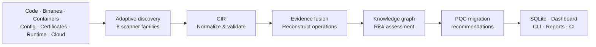
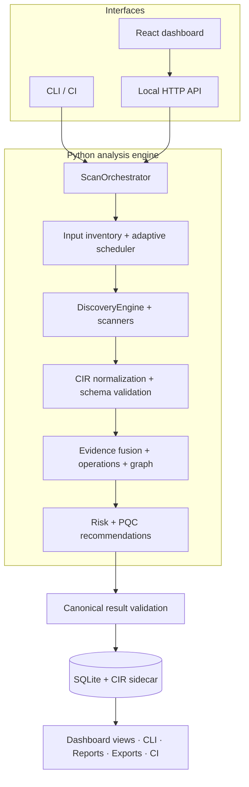

# ECDAT

**Cryptographic discovery, risk assessment, and post-quantum migration planning.**

ECDAT helps teams understand **where cryptography exists, how it is used, what is at risk, and what to migrate first**. It analyzes source code, dependencies, binaries, containers, configurations, certificates, and opt-in runtime or cloud targets, then turns scattered findings into a traceable cryptographic inventory and actionable migration guidance.

Use it from a **local dashboard**, **command-line interface**, or **CI pipeline**. All three run through the same analysis engine.

> **Why it matters:** Finding an RSA dependency is not the same as proving an application uses RSA to sign data. ECDAT tracks evidence and confidence, connects cryptographic assets to actual operations, and prioritizes risks rather than treating every detection equally.

## Get started

**Requirements:** Python 3.10+, Node.js 18+, and npm. Docker, Syft, and AWS credentials are needed only for relevant optional scans.

```bash
git clone https://github.com/vanishajr/ECDAT.git
cd ECDAT

# Install the Python application
python -m pip install -e .

# Analyze this repository; create a local SQLite database
python -m ecdat.cli scan ./ecdat --db .ecdat.db
```

To launch the dashboard, run one command from the repository root (starts the
local API at http://127.0.0.1:8734 and the dashboard at
http://localhost:5173 together; runs `npm install` automatically on first
use):

```bash
python dev.py
```

Open **http://localhost:5173**. Upload a project, enter a public GitHub repository URL, or select a demo, then inspect findings, inventory, risk, graph relationships, and migration guidance.

**Tip:** Point the CLI and dashboard at the same `--db` file to inspect the same stored scans. If you omit `--db`, the default is `~/.ecdat/ecdat.db`.

## How ECDAT works



1. **Discover.** Classify inputs, select relevant scanners, and report when optional tools are unavailable.
2. **Normalize.** Convert observations into the **Cryptographic Inventory Representation (CIR)**, a common model of assets, operations, context, and evidence.
3. **Correlate.** Merge overlapping signals and assess whether cryptography is directly used, likely used, merely present as a dependency, or a suspected false positive.
4. **Analyze.** Build relationships between assets and operations; assess classical weaknesses, quantum exposure, and deployment context.
5. **Act.** Produce prioritized post-quantum recommendations, inventories, reports, and CI findings.

### What makes the analysis useful?

| Capability | What it provides |
|---|---|
| **Evidence-aware inventory** | Findings with locations, provenance, confidence, and usage state—not just keyword matches |
| **Adaptive scanning** | Input-aware routing and scan profiles (`quick`, `standard`, `deep`), with optional deeper analysis |
| **Crypto knowledge graph** | Connections between cryptographic assets, operations, and application context |
| **Contextual risk** | Severity informed by quantum vulnerability, exposure, criticality, confidence, and Mosca-style migration timing |
| **Migration planning** | Prioritized, operation-aware recommendations, including standardized PQC and hybrid approaches where applicable |
| **One analysis core** | CLI, dashboard, and CI consume the same scan pipeline and persisted result models |

## Architecture



**Backend:** Python implements scanner orchestration, CIR models, evidence fusion, graph construction, risk scoring, recommendations, and SQLite persistence. **Frontend:** React + Vite provides scan intake, progress, inventory, evidence, graph exploration, and migration views. CLI and GUI share `ScanOrchestrator.scan()` rather than separate analysis implementations.

CIR captures **what was observed and why it matters**; the canonical scan result supports consistent findings, reports, and integrations. Results also retain scan diagnostics, such as scanner availability and execution metadata.

For module boundaries and detailed algorithms, see [Architecture](docs/ARCHITECTURE.md).

## Supported discovery surfaces

| Surface | Examples | Notes |
|---|---|---|
| **Source code** | Python, C/C++, Java, Go, JavaScript/TypeScript; API calls and custom implementations | Static analysis; optional Semgrep |
| **Dependencies** | Python, Node, Rust, Go, Maven manifests; SBOMs | Dependency presence is **not** treated as confirmed use |
| **Binaries** | ELF, PE, Mach-O; constants, OIDs, symbols | Optional external analysis tools |
| **Containers** | OCI images, Docker archives, root filesystems, Dockerfiles | Some modes require Docker or Syft |
| **Configuration** | Nginx, Apache, Kubernetes, Terraform, OpenSSL, Envoy | TLS and crypto settings |
| **Certificates & keys** | PEM, DER, JWK, PKCS#12, JKS, SSH | Metadata and algorithm identification |
| **Runtime** | TLS endpoints, SSH banners | Requires explicit opt-in |
| **Cloud** | AWS KMS, ACM, ELB/ALB | AWS supported; Azure/GCP not implemented |

## Use the CLI

### Scan a target

```bash
# Source repository
python -m ecdat.cli scan ./my-project --db .ecdat.db

# Public GitHub repository
python -m ecdat.cli scan --repo https://github.com/openssl/openssl --db .ecdat.db

# Produce canonical JSON and CIR alongside the database entry
python -m ecdat.cli scan ./my-project --output findings.json --cir-out cir.json --db .ecdat.db
```

### Review and export results

```bash
# Find a scan ID
python -m ecdat.cli list --db .ecdat.db

# Replace <scan-id> with the ID from the list command
python -m ecdat.cli show <scan-id> --db .ecdat.db
python -m ecdat.cli risk <scan-id> --db .ecdat.db
python -m ecdat.cli recommend <scan-id> --db .ecdat.db

# Reports and machine-readable outputs
python -m ecdat.cli report <scan-id> --format html --output report.html --db .ecdat.db
python -m ecdat.cli export <scan-id> --format sarif --output findings.sarif --db .ecdat.db
```

### Add a CI security gate

```bash
python -m ecdat.cli ci ./my-project --fail-on high --summary --db .ecdat.db
```

This exits unsuccessfully when findings reach the chosen severity threshold, making it suitable for automated checks.

<details>
<summary><strong>More scan modes and output formats</strong></summary>

```bash
# Limit scanner families
python -m ecdat.cli scan ./my-project --scanners source,config,certificate

# Analyze a binary
python -m ecdat.cli scan-binary ./build/app

# Analyze a container archive or explicitly allow an image scan
python -m ecdat.cli scan-container ./image.tar
python -m ecdat.cli scan-container nginx:1.25 --allow-container

# AWS inventory (requires authorized credentials)
python -m ecdat.cli scan-cloud aws --profile readonly --services kms,acm,elb
```

**Reports:** Markdown, console, HTML, PDF. **Exports:** JSON, CSV, CycloneDX CBOM (JSON/XML), SARIF. Use `python -m ecdat.cli --help` or the appropriate command's `--help` for options.

</details>

## Risk and migration guidance

ECDAT goes beyond naming vulnerable algorithms. It estimates risk using **cryptographic exposure, application criticality, evidence confidence, and migration urgency**. Mosca-style timing considers how long data must remain protected, how long migration could take, and the assumed quantum threat horizon.

Recommendations are **operation-aware**: encryption, signatures, key exchange, and other use cases have different replacement paths. The recommendation registry includes options based on **ML-KEM, ML-DSA, SLH-DSA**, and hybrid approaches when appropriate. Risks determine priority; recommendations still require compatibility and deployment validation.

ECDAT is an **assessment and planning tool**, not an automatic cryptographic code migrator. Effort estimates are rough planning aids, not committed timelines.

## Results you can use

- **Dashboard:** scan overview, findings and evidence, cryptographic inventory, relationship graph, migration recommendations, coverage.
- **Reports:** readable summaries for security reviews and migration discussions.
- **Integrations:** JSON/CIR for downstream processing, CycloneDX CBOM for inventory exchange, SARIF for code-scanning workflows, CSV for analysis.
- **SQLite:** local scan history and diagnostics; repeated identical inputs can reuse deterministic scan identities.

## Validation and limitations

The project includes unit, regression, contract, and end-to-end tests, plus a synthetic benchmark suite. See [Benchmark methodology](docs/BENCHMARKS.md) for datasets, metrics, and reproduced results rather than relying on an unexplained headline score.

```bash
python -m pytest -q
```

**Current scope:** Static evidence does not guarantee runtime execution; scanning cannot prove that every cryptographic operation has been found. Optional tools affect coverage and are reported when unavailable. AWS cloud discovery is implemented; Azure and GCP are not. Runtime/cloud probing is opt-in. The local dashboard is loopback-only and is not a production multi-user service.

## Security and privacy

The dashboard binds to the local machine by default. Credentials should be supplied via environment variables or supported credential providers, not committed to Git. Archive processing applies extraction safeguards, and sensitive evidence is redacted where detected. Review generated outputs before sharing them, especially when scanning private repositories.

## Project structure

```text
ecdat/                 Python package
  core/                CIR, orchestration, fusion, graph, risk, migration
  scanners/            Eight discovery families
  commands/            CLI commands and shared scan persistence
  store/               SQLite persistence
  reports/             Human-readable reports
  exports/             CBOM, SARIF, CSV, JSON
  web/                 Local dashboard API
frontend/               React + Vite interface
tests/                  Automated tests and contracts
ECDAT_Benchmark_Suite/  Benchmark runner, fixtures, ground truth
docs/                   Architecture and benchmark details
```

**More information:** [Architecture](docs/ARCHITECTURE.md) · [Benchmarks](docs/BENCHMARKS.md)

---

**ECDAT turns cryptographic detections into an evidence-backed inventory, a prioritized risk picture, and a practical starting point for post-quantum migration.**
